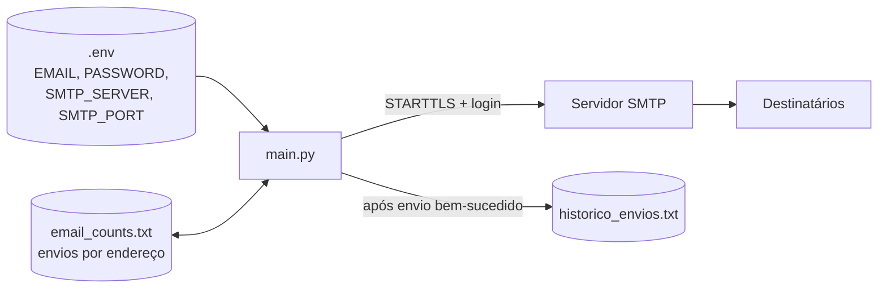

# Automação de e-mails

**Envio de e-mails pelo terminal via SMTP, com seleção rápida dos contatos mais usados, envio para vários destinatários, histórico com data e hora e reenvio da última mensagem.**

[](https://www.python.org/)
[](https://docs.python.org/3/library/smtplib.html)
[](.env.example)
[](../)

Para quem manda o mesmo tipo de mensagem com frequência: o programa memoriza os endereços já usados, conta quantas vezes cada um recebeu e-mail e oferece os mais frequentes num menu numerado, sem precisar redigitá-los.

---

## Sumário

- [Destaques](#destaques)
- [Como funciona](#como-funciona)
- [Como executar](#como-executar)
- [Uso](#uso)
- [Estrutura do projeto](#estrutura-do-projeto)
- [Limitações](#limitações)

---

## Destaques

- **Contatos frequentes:** os 5 endereços mais usados aparecem numerados, com a quantidade de envios.
- **Vários destinatários:** digitados separados por vírgula ou escolhidos por índice (`1,3,5`).
- **Corpo flexível:** digitado no terminal (termina com `FIM`) ou lido de um arquivo de texto.
- **Histórico:** cada envio é registrado com data, hora, destinatário e assunto.
- **Reenvio:** o último assunto e corpo podem ser reaproveitados para novos destinatários.
- **Credenciais fora do código:** lidas de um `.env` local, que não é versionado.

## Como funciona



A mensagem é montada com `MIMEMultipart` em texto puro UTF-8 e enviada por `smtplib` com `STARTTLS`. Só depois de um envio bem-sucedido o programa incrementa a contagem de cada destinatário e grava o histórico, de modo que falhas de autenticação ou rede não poluem os registros.

## Como executar

```bash
cd Automacao-emails
pip install -r requirements.txt
cp .env.example .env      # Windows: copy .env.example .env
python3 main.py
```

Preencha o `.env` com o seu endereço e uma [senha de app do Gmail](https://myaccount.google.com/apppasswords) (exige verificação em duas etapas; o Gmail não aceita a senha da conta por SMTP). Para outro provedor, ajuste `SMTP_SERVER` e `SMTP_PORT`. Sem `EMAIL` e `PASSWORD`, o programa avisa e encerra.

## Uso

```text
1 - Enviar novo e-mail
2 - Listar histórico de envios
3 - Reenviar o último e-mail para novo(s) destinatário(s)
4 - Sair
```

Na escolha de destinatários, digite o número de um contato frequente, `0` para um endereço novo ou `99` para vários. No corpo, a opção 1 lê linhas até uma linha contendo só `FIM`; a opção 2 lê um arquivo `.txt`.

Exemplo de `historico_envios.txt`:

```text
04/11/2026 09:15:02 | ana@exemplo.com | Relatório semanal
04/11/2026 09:15:02 | bia@exemplo.com | Relatório semanal
```

## Estrutura do projeto

| Arquivo | Descrição |
|---|---|
| `main.py` | Menu, seleção de destinatários, montagem e envio da mensagem |
| `.env.example` | Modelo das credenciais; copie para `.env` |
| `requirements.txt` | Dependência externa (`python-dotenv`) |
| `email_counts.txt` | Gerado no uso: contagem de envios por endereço |
| `historico_envios.txt` | Gerado no uso: registro de cada envio |

## Limitações

- O "último e-mail" fica só na memória: ao fechar o programa, a opção 3 não tem o que reenviar.
- Apenas texto puro, sem anexos nem HTML.
- Os endereços não são validados; um endereço inválido só é detectado pelo servidor SMTP.
- Os arquivos de dados são gravados no diretório atual, por isso o programa deve ser executado de dentro da pasta.

---

[← Automatizando com Python](../)
