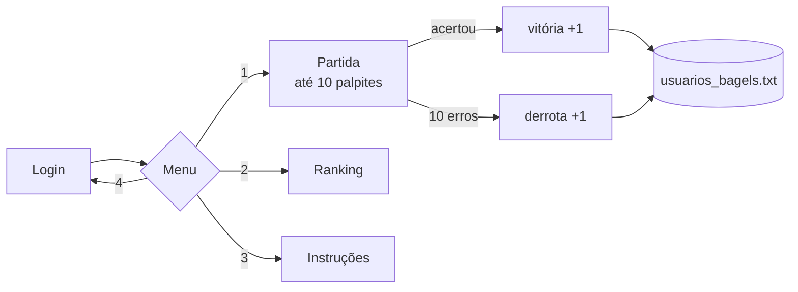

# Bagels

**Jogo de dedução lógica: descobrir um número secreto de 3 dígitos distintos em até 10 tentativas, guiado pelas dicas Fermi, Pico e Bagels, com contas de jogador e ranking.**

[](https://www.python.org/)
[](#estrutura-do-projeto)
[](../)

Implementação em Python do clássico jogo de adivinhação com dicas posicionais. Toda a lógica fica na classe `JogoBagels`, que também cuida das contas e das estatísticas de cada jogador.

---

## Sumário

- [Regras](#regras)
- [Destaques](#destaques)
- [Como funciona](#como-funciona)
- [Como executar](#como-executar)
- [Estrutura do projeto](#estrutura-do-projeto)
- [Limitações](#limitações)

---

## Regras

O número secreto tem 3 dígitos diferentes e não começa com 0. A cada palpite (também com 3 dígitos diferentes), o jogo responde com uma dica por dígito acertado:

| Dica | Significado |
|---|---|
| **Fermi** | Dígito certo na posição certa |
| **Pico** | Dígito certo na posição errada |
| **Bagels** | Nenhum dígito do palpite está no número |

Com o número secreto `427` e o palpite `123`, a resposta é `Pico`: o `2` existe, mas em outra posição. As dicas saem com todos os Fermi primeiro e depois os Pico, de modo que a ordem não revela qual dígito gerou cada uma.

## Destaques

- **Login simples:** um nome novo cria a conta automaticamente; um nome existente recupera as estatísticas.
- **Ranking** com vitórias, derrotas, total de partidas e taxa de vitória.
- **Palpites validados:** exatamente 3 dígitos, só números, sem repetição.
- **Troca de usuário** sem sair do jogo.

## Como funciona



O número secreto é sorteado embaralhando os dígitos de `0` a `9` e pegando os três primeiros; se o primeiro for `0`, ele troca de lugar com um dígito não nulo. As estatísticas são gravadas em `usuarios_bagels.txt`, uma linha `nome,vitórias,derrotas` por jogador, ao fim de cada partida.

## Como executar

```bash
cd Jogos/Bagels
python3 main.py
```

```text
1.  Iniciar nova partida
2.  Ver ranking
3.  Ver instruções
4.  Trocar usuário
5.  Sair do jogo
```

## Estrutura do projeto

| Arquivo | Descrição |
|---|---|
| `main.py` | Classe `JogoBagels`: contas, sorteio, dicas, partida e ranking |
| `usuarios_bagels.txt` | Gerado no uso: estatísticas dos jogadores |

## Limitações

- O ranking ordena só pelo número de vitórias, sem desempate pela taxa.
- Os nomes diferenciam maiúsculas de minúsculas (`Ana` e `ana` são contas distintas) e não podem conter vírgula, o separador do arquivo.

---

[← Jogos](../) · [Repositório principal](../../)
