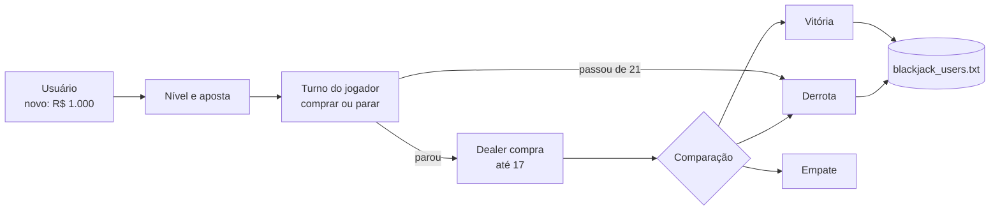

# BlackJack

**Vinte e um contra o dealer no terminal, com saldo virtual por jogador, três níveis de aposta e ranking persistente.**

[](https://www.python.org/)
[](#estrutura-do-projeto)
[](../)

Cada jogador novo começa com R$ 1.000,00 de saldo virtual. O objetivo é somar mais pontos que o dealer sem passar de 21; o saldo, as vitórias e as derrotas ficam salvos entre execuções.

---

## Sumário

- [Regras](#regras)
- [Destaques](#destaques)
- [Como funciona](#como-funciona)
- [Como executar](#como-executar)
- [Estrutura do projeto](#estrutura-do-projeto)
- [Limitações](#limitações)

---

## Regras

| Carta | Valor |
|---|---|
| 2 a 10 | Valor nominal |
| J, Q, K | 10 |
| Ás | 11, ou 1 se a mão passar de 21 |

O jogador compra cartas (`C`) ou para (`P`). Depois, o dealer revela a carta escondida e compra até somar pelo menos 17. Ganha quem tiver mais pontos sem estourar; se o dealer estourar, o jogador ganha. Vitória soma a aposta ao saldo, derrota subtrai, e empate devolve a aposta.

| Nível | Aposta mínima | Aposta máxima |
|---|---|---|
| Fácil | R$ 10,00 | R$ 100,00 |
| Médio | R$ 50,00 | R$ 300,00 |
| Difícil | R$ 100,00 | R$ 500,00 |

A aposta máxima também é limitada pelo saldo. Um nível cuja aposta mínima passa do saldo não pode ser escolhido, e com menos de R$ 10,00 o jogador está fora: é preciso criar outro usuário.

## Destaques

- **Ás flexível:** `calcular_valor_mao` conta cada Ás como 11 e desconta 10 por Ás enquanto a mão passar de 21.
- **Carta do dealer escondida** até o fim do turno do jogador.
- **Ranking** dos 10 jogadores com mais vitórias, com saldo e estatísticas globais (partidas e taxa de vitória geral).
- **Fim de jogo por falência:** ao zerar o saldo, a conta deixa de poder jogar.

## Como funciona



Os jogadores ficam em `blackjack_users.txt`, com cabeçalho e uma linha `NOME|VITORIAS|DERROTAS|DINHEIRO|DATA_CRIACAO` por jogador. O arquivo é relido e regravado a cada partida, de modo que o saldo nunca fica só na memória.

## Como executar

```bash
cd Jogos/BlackJack
python3 main.py
```

```text
1️   INICIAR PARTIDA
2️   VER RANKING
3️   SAIR DO JOGO
```

## Estrutura do projeto

| Arquivo | Descrição |
|---|---|
| `main.py` | Classe `BlackJackGame`: contas, apostas, partida e ranking |
| `blackjack_users.txt` | Gerado no uso: jogadores, estatísticas e saldo |

## Limitações

- Baralho infinito: cada carta é sorteada com reposição, então as probabilidades não mudam ao longo da mão.
- Sem *split*, *double down*, seguro, nem pagamento 3:2 para o blackjack natural.
- O empate não conta como vitória nem como derrota nas estatísticas.
- Os nomes não podem conter `|`, o separador do arquivo.

---

[← Jogos](../) · [Repositório principal](../../)
