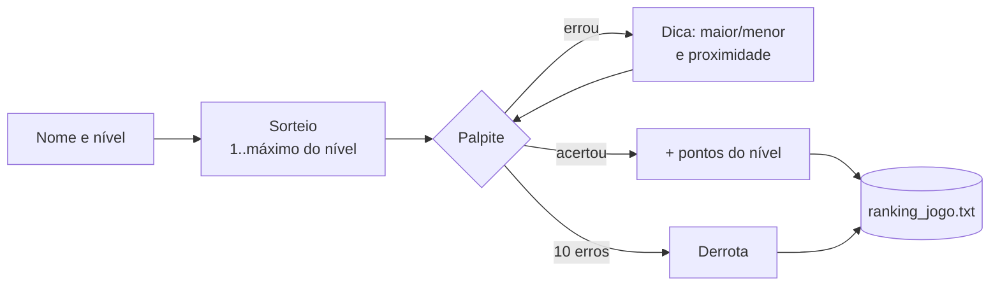

# Adivinhe o Número

**Jogo de adivinhação com cinco níveis de dificuldade, dicas de proximidade e direção, pontuação por nível e ranking dos jogadores.**

[](https://www.python.org/)
[](#como-executar)
[](../)

O jogador tem 10 tentativas para descobrir um número sorteado num intervalo que cresce com a dificuldade. Quanto mais difícil o nível, mais pontos a vitória vale no ranking.

---

## Sumário

- [Regras](#regras)
- [Destaques](#destaques)
- [Como funciona](#como-funciona)
- [Como executar](#como-executar)
- [Estrutura do projeto](#estrutura-do-projeto)
- [Limitações](#limitações)

---

## Regras

| Nível | Intervalo | Pontos por vitória |
|---|---|---|
| 1 · Fácil | 1 a 50 | 100 |
| 2 · Médio | 1 a 100 | 200 |
| 3 · Difícil | 1 a 200 | 400 |
| 4 · Muito difícil | 1 a 500 | 700 |
| 5 · Insano | 1 a 1000 | 1000 |

A cada palpite errado, o jogo diz se o número é maior ou menor e o quão perto o palpite está, em proporção ao tamanho do intervalo:

| Distância | Dica |
|---|---|
| até 10% | Muito perto |
| até 20% | Perto |
| até 30% | Razoavelmente perto |
| até 50% | Longe |
| mais de 50% | Muito longe |

## Destaques

- **Dica proporcional:** errar por 10 é "muito perto" no nível Insano e "perto" no Fácil.
- **Ranking por pontuação total**, com medalhas para os três primeiros, vitórias, derrotas e taxa de vitória.
- **Estatísticas após cada partida**, incluindo os pontos ganhos nela.
- **Entradas validadas:** nível de 1 a 5 e palpite dentro do intervalo.

## Como funciona



O ranking fica em `ranking_jogo.txt`, uma linha `usuario|vitorias|derrotas|taxa|pontuacao` por jogador. Os nomes são normalizados para minúsculas, então `Ana` e `ana` somam na mesma conta.

## Como executar

```bash
cd "Jogos/Guess the Number"
python3 main.py
```

```text
1️  Iniciar novo jogo
2️  Ver ranking
3️  Sair
```

## Estrutura do projeto

| Arquivo | Descrição |
|---|---|
| `main.py` | Menu, partida, dicas e ranking |
| `ranking_jogo.txt` | Gerado no uso: estatísticas e pontuação dos jogadores |

## Limitações

- Não há senha: qualquer pessoa pode jogar com o nome de outra e alterar as estatísticas dela.
- Nome vazio vira `anônimo`, que acumula as partidas de todos que não se identificam.
- O caractere `|` é removido dos nomes, por ser o separador do arquivo.

---

[← Jogos](../) · [Repositório principal](../../)
