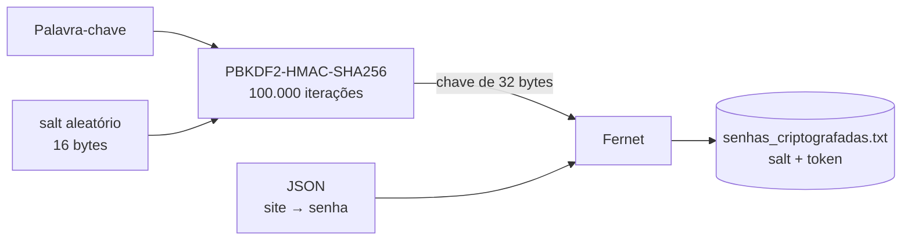

# Gerador de senhas com cofre criptografado

**Gera senhas fortes com o módulo `secrets` e as guarda num cofre local criptografado com Fernet, cuja chave é derivada de uma palavra-chave mestra por PBKDF2.**

[](https://www.python.org/)
[](https://cryptography.io/)
[](#como-funciona)
[](../)

Uma alternativa a guardar senhas num bloco de notas ou numa planilha sem proteção. Projeto de estudo inspirado em *Automate the Boring Stuff with Python* (Al Sweigart), cobrindo expressões regulares, aleatoriedade criptográfica, criptografia simétrica e derivação de chave.

---

## Sumário

- [Destaques](#destaques)
- [Como funciona](#como-funciona)
- [Como executar](#como-executar)
- [Estrutura do projeto](#estrutura-do-projeto)
- [Limitações](#limitações)

---

## Destaques

- **Senhas fortes:** no mínimo 8 caracteres, com ao menos uma maiúscula, uma minúscula e um dígito, conferidos por regex.
- **Aleatoriedade criptográfica:** `secrets.choice` e `secrets.SystemRandom().shuffle`, nunca o módulo `random`.
- **Cofre criptografado:** o arquivo guarda só o *salt* e o texto cifrado; sem a palavra-chave, não revela nada.
- **Palavra-chave nunca gravada:** a chave é derivada dela a cada execução.
- **Atualização por site:** gerar de novo para um site já existente substitui a senha antiga.

## Como funciona



O cofre é um dicionário `{site: senha}` serializado em JSON. A cada gravação, um novo *salt* é sorteado, a chave é derivada e o JSON é cifrado com Fernet (AES-128 em modo CBC com autenticação HMAC-SHA256). Na leitura, os 16 primeiros bytes do arquivo são o *salt*; uma palavra-chave errada faz a verificação do HMAC falhar (`InvalidToken`) e o programa encerra sem tocar no arquivo.

## Como executar

```bash
cd gerador_de_senhas.py
pip install -r requirements.txt
python3 gerador_de_senhas.py
```

Na primeira execução, a palavra-chave digitada cria o cofre; nas seguintes, a mesma palavra-chave é exigida.

```text
1 - Gerar nova senha para um site/aplicação
2 - Listar todas as senhas armazenadas
3 - Sair
```

## Estrutura do projeto

| Arquivo | Descrição |
|---|---|
| `gerador_de_senhas.py` | Geração, validação, criptografia e menu |
| `requirements.txt` | Dependência externa (`cryptography`) |
| `senhas_criptografadas.txt` | Gerado no uso: *salt* + dados cifrados (binário, apesar da extensão) |

## Limitações

- Não há como recuperar a palavra-chave: esquecê-la significa perder o cofre.
- As senhas geradas usam só letras e dígitos, sem símbolos.
- As senhas aparecem em texto puro no terminal ao serem geradas e listadas.
- Não é possível excluir uma entrada nem trocar a palavra-chave pelo menu.

---

[← Automatizando com Python](../)
