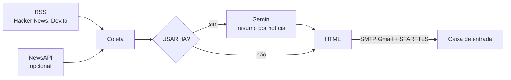

# Tech News Digest

**Robô diário de notícias de tecnologia: coleta manchetes do Hacker News, do Dev.to e da NewsAPI, opcionalmente resume cada uma com o Google Gemini e envia tudo num e-mail em HTML.**

[](https://www.python.org/)
[](https://feedparser.readthedocs.io/)
[](https://newsapi.org/)
[](https://aistudio.google.com/)
[](../)

Acompanhar novidades de programação toma tempo e vira procrastinação fácil. Este script reúne as notícias do dia num único e-mail, num formato limpo, e pode ser agendado para rodar sozinho todas as manhãs.

---

## Sumário

- [Destaques](#destaques)
- [Como funciona](#como-funciona)
- [Como executar](#como-executar)
- [Agendamento diário](#agendamento-diário)
- [Estrutura do projeto](#estrutura-do-projeto)
- [Limitações](#limitações)

---

## Destaques

- **Três feeds RSS sem chave:** Hacker News (página inicial), Dev.to `#python` e Dev.to `#webdev`, 5 notícias de cada.
- **NewsAPI opcional:** 3 artigos por tópico (`programming`, `artificial intelligence`, `software development`, `devops`, `python`), sem títulos repetidos e sem os artigos marcados como `[Removed]`.
- **Resumos por IA opcionais:** com `USAR_IA = True` e uma chave do Gemini, cada notícia ganha um resumo de até 20 palavras e uma frase sobre por que ela importa.
- **E-mail em HTML** com fonte, título com link, descrição e data de cada notícia.
- **Falhas isoladas:** um feed ou tópico que falha é registrado no terminal e os demais continuam.

## Como funciona



Os feeds são baixados com `requests` e só então interpretados pelo `feedparser`. Deixar o `feedparser` baixar a URL sozinho usa o `urllib`, que no Python do macOS costuma falhar na verificação SSL **sem lançar exceção**, devolvendo uma lista vazia; com `requests`, os certificados vêm do `certifi` e os erros aparecem.

## Como executar

```bash
cd tech-news-digest
python3 -m venv .venv && source .venv/bin/activate   # Windows: .venv\Scripts\activate
pip install -r requirements.txt
cp .env.example .env                                 # Windows: copy .env.example .env
python3 news_digest.py
```

No `.env`, preencha:

| Variável | Obrigatória | Descrição |
|---|---|---|
| `EMAIL_ORIGEM` | sim | Conta Gmail que envia |
| `EMAIL_DESTINO` | sim | Quem recebe (pode ser o mesmo endereço) |
| `GMAIL_APP_PASSWORD` | sim | [Senha de app](https://myaccount.google.com/apppasswords) de 16 caracteres; os espaços são removidos |
| `NEWS_API_KEY` | não | Chave gratuita da [NewsAPI](https://newsapi.org/) (100 requisições/dia) |
| `GEMINI_API_KEY` | não | Chave do [Google AI Studio](https://aistudio.google.com/); usada só com `USAR_IA = True` em `news_digest.py` |

Sem as três variáveis obrigatórias, o script avisa e encerra antes de coletar.

## Agendamento diário

Linux e macOS, com `crontab -e` (todo dia às 7h):

```cron
0 7 * * * cd /caminho/para/tech-news-digest && .venv/bin/python news_digest.py >> digest.log 2>&1
```

No Windows, crie uma tarefa no Agendador de Tarefas que execute `.venv\Scripts\python.exe news_digest.py` com a pasta do projeto como diretório inicial.

## Estrutura do projeto

| Arquivo | Descrição |
|---|---|
| `news_digest.py` | Coleta, resumo opcional, montagem do HTML e envio |
| `.env.example` | Modelo das variáveis; copie para `.env` |
| `requirements.txt` | Dependências (`google-generativeai` só é necessária com IA) |

## Limitações

- `USAR_IA` é uma constante no código, e não uma variável do `.env`.
- A biblioteca `google-generativeai` foi descontinuada pelo Google em favor de `google-genai`; o script ainda usa a antiga.
- O envio é fixo no SMTP do Gmail (`smtp.gmail.com:587`).
- Notícias repetidas entre os feeds RSS e a NewsAPI não são removidas.
- As descrições dos feeds entram no HTML como vêm, sem sanitização.

---

[← Automatizando com Python](../)
